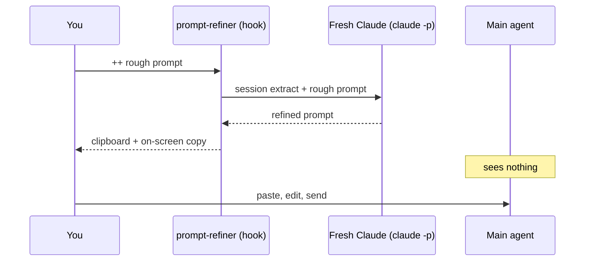

# prompt-refiner

Type a rough prompt in Claude Code. Get a precise one back in your clipboard, before the agent sees anything.

A `UserPromptSubmit` hook catches prompts that start with `++`, hands them to a fresh headless Claude together with an extract of your session, and returns one refined paragraph. The main agent never sees the rough prompt, the refiner, or its reasoning.

## Demo

The session so far: the agent read `tests/test_auth.py`, ran `pytest`, saw `KeyError: 'session'`, and edited `auth/session.py` to rename the cookie to `sid`.

You type:

```
++ fix the broken test
```

Eight seconds later, this is in your clipboard:

```
Fix tests/test_auth.py::test_login_sets_cookie, which fails with KeyError: 'session'
because auth/session.py line 42 now sets the cookie as `sid`. Assume the rename to
`sid` is intentional, so update the test to assert resp.cookies['sid'] and don't
revert the cookie name in auth/session.py. If that assumption is wrong, or if the
last edit to auth/session.py changed the cookie name again, stop and say so before
changing anything. Don't touch other clients that read the cookie, but list any you
notice. Check the result with pytest tests/test_auth.py -x.
```

The refined prompt names the file, the test, the error, and the cause. It states one assumption. It asks for verification. Every fact came from the session transcript. Nothing came from the main agent.

The example is reproducible: it is the fixture in `tests/`, and `./tests/run.sh --live` regenerates it. Prompts in other languages come back in that language.

## How it works



1. The hook catches every prompt that starts with `++`.
2. It reads the tail of the session transcript and sends it, with your rough prompt, to a new headless Claude.
3. The new Claude returns one paragraph: the refined prompt.
4. The hook copies it to the clipboard and blocks the original prompt.
5. You clear the input, paste, edit, and press Enter.

**Why a separate Claude?** The main agent is already shaped by its context. Asking it to improve a prompt adds more tokens to that context, and its view of the task is the view you may want to escape. A fresh Claude reads a compact extract, has no stake in the session, and leaves nothing behind.

## Two modes

| You type | What happens |
|---|---|
| `++ prompt` | Refine, copy to the clipboard, block. You edit before you send. |
| `++! prompt` | Refine and run. The main agent executes the refined version. You do not see it first. |

Every other prompt passes through untouched, in milliseconds.

## Install

```sh
git clone https://github.com/marciob/prompt-refiner.git
cd prompt-refiner
./scripts/install.sh
```

Then restart Claude Code, or type `/hooks` once, so the hook loads.

The script adds one entry to `~/.claude/settings.json` and keeps your other hooks. It saves a backup first. To uninstall, run `./scripts/install.sh --remove`.

**Requirements**

- Claude Code 2.1 or later, logged in. The refiner uses the same login as your session.
- `jq` and `perl`. Both come with macOS.
- A clipboard tool: `pbcopy` on macOS, `wl-copy` or `xclip` on Linux.

## Use

1. Type `++` and your prompt. Press Enter.
2. Wait 5 to 20 seconds. Claude Code shows "UserPromptSubmit operation blocked by hook" and the refined prompt under it. That header is Claude Code's fixed label for a blocked prompt. The block is the point.
3. Press `Esc` to clear the input. Claude Code puts the blocked text back there.
4. Paste with `Cmd+V` (macOS) or `Ctrl+Shift+V` (most Linux terminals). Edit. Press Enter.

## Tune it

`prompts/refiner.md` is the whole brain. It tells the refiner what a good prompt carries (goal, file anchors, constraints, deliverable, verification) and what to keep from you (language, voice, intent). Edit it and the next `++` uses it. No restart.

## Configuration

Set these in the environment, or in `~/.config/prompt-refiner/env`.

| Variable | Default | Meaning |
|---|---|---|
| `PROMPT_REFINER_MODEL` | `sonnet` | Model for the refiner. |
| `PROMPT_REFINER_TIMEOUT` | `75` | Seconds before the hook stops the refiner. Keep it below the hook timeout of 90. |
| `PROMPT_REFINER_CONTEXT_CHARS` | `12000` | Size of the transcript extract sent to the refiner. |
| `PROMPT_REFINER_STATE_DIR` | `~/.claude/prompt-refiner` | Where the hook writes logs and the last prompt. |
| `PROMPT_REFINER_CLAUDE_BIN` | auto | Path to the `claude` binary, if the hook cannot find it. |
| `PROMPT_REFINER_SYSTEM_FILE` | `prompts/refiner.md` | The refiner's instructions. |

## Debug

The hook writes to the state directory after every run:

| File | Content |
|---|---|
| `last-prompt.txt` | The last refined prompt. Use it if the clipboard failed. |
| `last-payload.txt` | What the refiner received. Read it when a result is weak. |
| `last-run.log` | One line per run: mode, model, exit code, seconds, sizes. |
| `last-error.log` | The stderr of the last run. |

If the refiner fails, the hook says so on screen and leaves your original prompt in the input. Remove the `++` and press Enter to send it as is.

## Limits

- Hooks can add context or block a prompt. They cannot replace it, and they cannot write into the input field. The clipboard is the bridge.
- A long refined prompt can collapse into a `[Pasted text]` block after you paste. The refiner writes one paragraph to reduce this. If it happens, send it as is, or lower the length in `prompts/refiner.md`.
- The hook runs where Claude Code runs. In a cloud session, the clipboard is not on your machine.
- Claude Code writes the transcript with a small delay. The last turn can be missing from the extract.
- Each `++` is one extra model call, 5 to 20 seconds.

## Tests

```sh
./tests/run.sh          # 8 offline tests, no model call
./tests/run.sh --live   # adds one real refinement with the fixture transcript
```

## License

MIT
